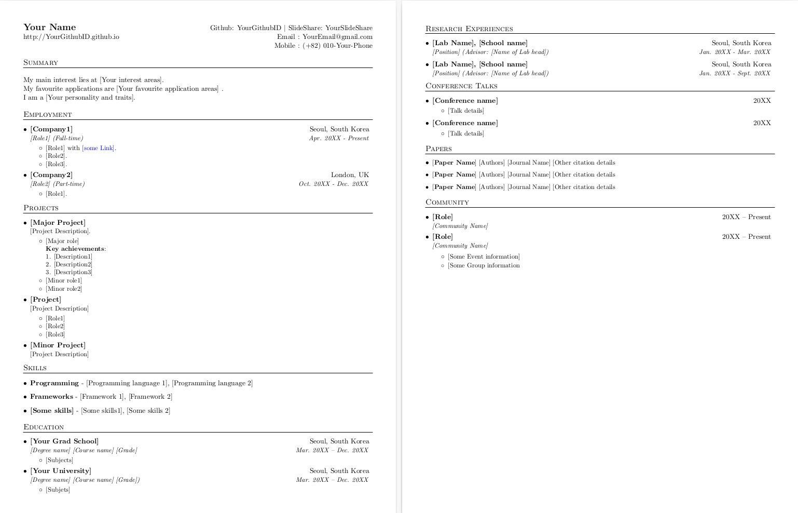
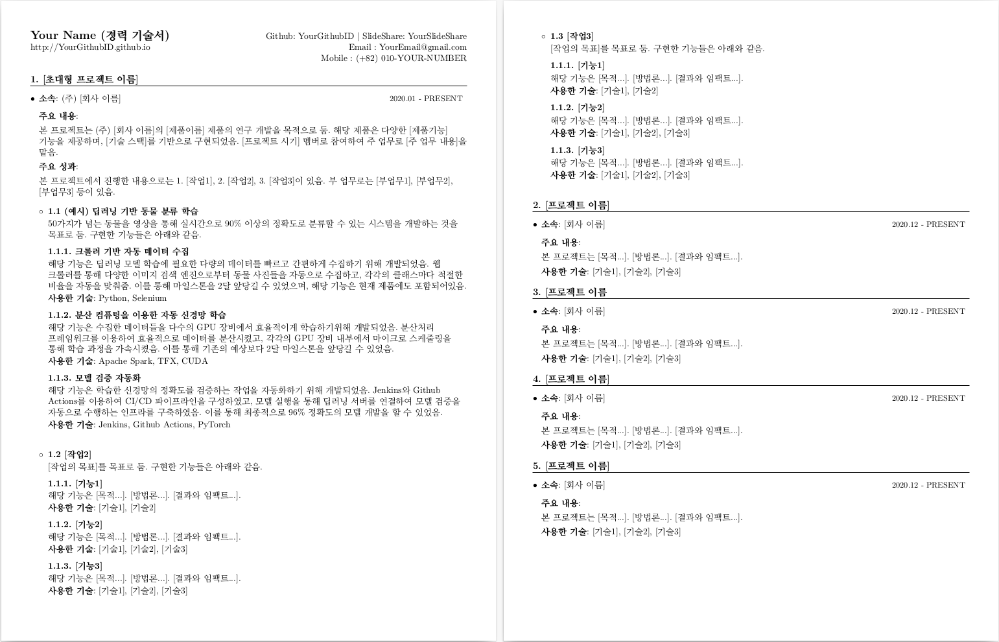

# latex_resume_template_kor

- 이력서 (CV/Resume)
- 경력기술서

...를 LaTeX로 이쁘게 적을 수 있게 해주는 템플릿 :smile:

# 사용 방법

OpenAI Prism을 이용해서 빠르게 제작해보세요! 

새 프로젝트를 생성하신 후, **이력서 템플릿** 또는 **경력기술서 템플릿** 파일을 복사/붙혀넣기 하신 후 ctrl + s 를 눌러 렌더링 하시면 됩니다.

[이력서 & 경력 기술서 만들기](https://prism.openai.com/?u=08bfba2d-1b3c-453c-aa77-b07af011e646&pg=1&m=resume.tex&d=7)

`/Curriculum_Vitae_Template` 폴더에는 **이력서 템플릿**이 있습니다. [파일](https://github.com/changh95/resume_template_kor/blob/main/Curriculum_Vitae_Template/resume.tex)

`/Work_Experiences_Template` 폴더에는 **경력기술서 템플릿**이 있습니다. [파일](https://github.com/changh95/resume_template_kor/blob/main/Work_Experiences_Template/work_experience.tex)

1. 파일을 다운로드한다.
2. Tex 에디터를 통해 수정하고 렌더링한다. Tex 에디터에 대해 잘 모르신다면 [Overleaf](https://www.overleaf.com)을 추천드립니다.

# 예시

## 이력서

## 경력 기술서

(예시는 곧 만들어서 올릴게요!)

# 라이센스

이 repo에 있는 모든 tex 파일은 [sb2nov의 CV 템플릿](https://github.com/sb2nov/resume)을 수정하여 만들었고, 기존의 MIT 라이센스를 유지합니다.
